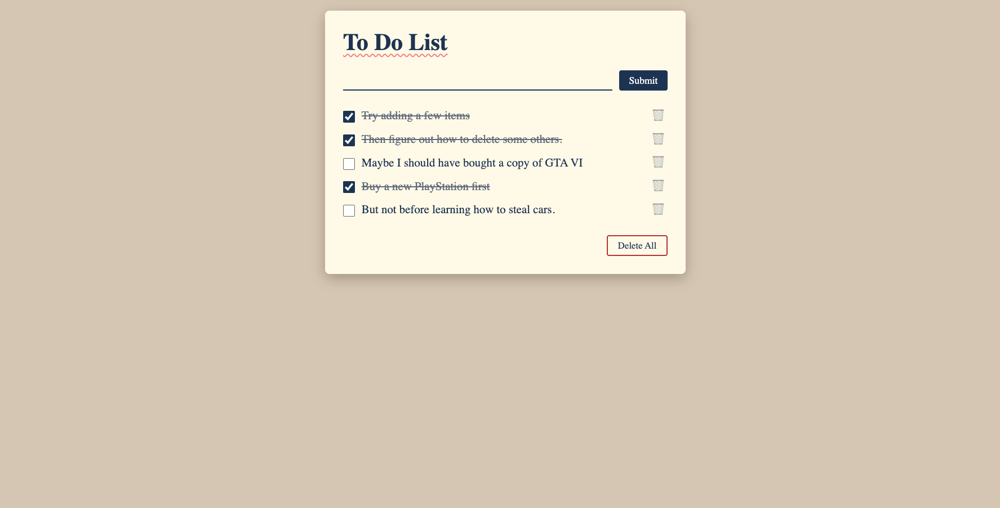

# ✅ To Do List

A simple to-do list that runs in the browser. Type a task, add it to the list, check it off when it's done, and delete it when you don't need it anymore. It's built with plain HTML, CSS and JavaScript, with no frameworks and no build step.

[Visit To Do List](https://addtomylist.netlify.app/)

## Project Preview



## 🛠️ Built with

- **HTML5**: a title, a text box with a submit button, an empty list and a Delete All button
- **CSS3**: CSS Grid for the layout, Google Fonts (Kalam), and `:has()` to fade checked tasks
- **Vanilla JavaScript**: event listeners and DOM creation with `createElement`

## How To Run Locally

1. Clone the repo:

```bash
git clone https://github.com/malcolmcpu/<your-repo-name>.git
```

2. Open the project folder.
3. Open `index.html` in your web browser.
   There's nothing to install.

## 📚 What I learned

- Creating elements with `createElement` and adding them with `appendChild` and `prepend`
- Listening for clicks and changes with `addEventListener`
- Using a ternary operator to turn the strike-through on and off
- Removing a single element with `remove()` and clearing a whole list with `innerHTML = ''`
- Laying out a page with CSS Grid and styling checked items with `:has()`
